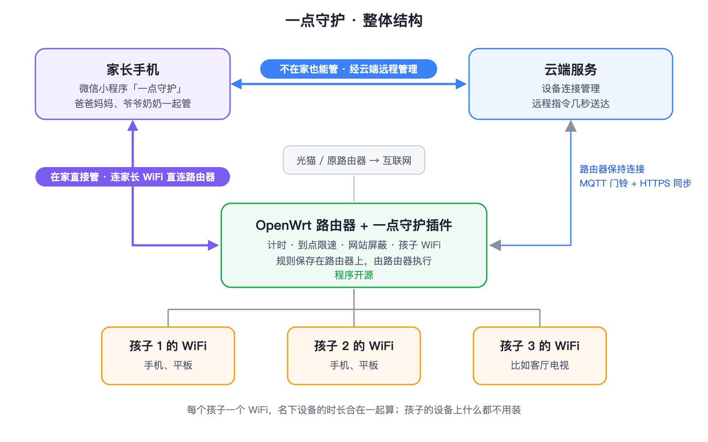
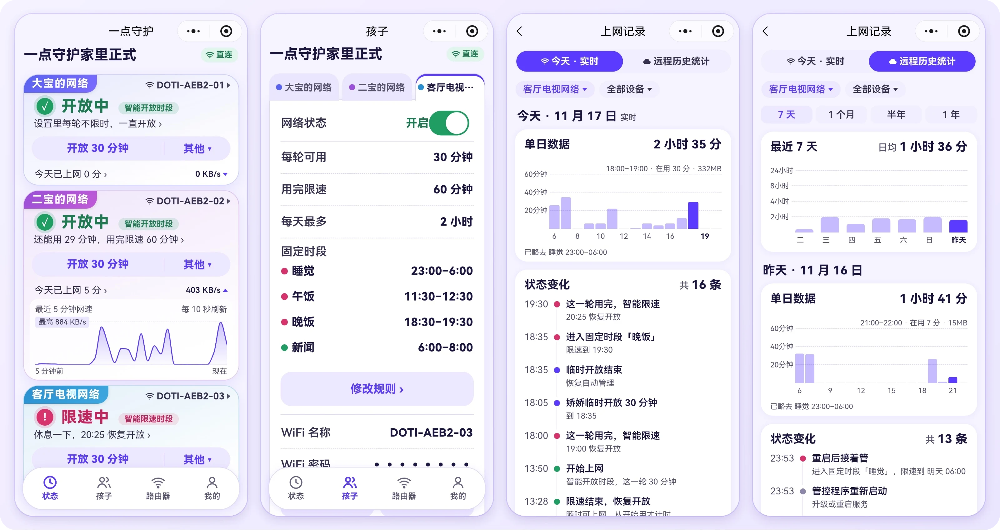

<div align="center">

<picture>
  <source media="(prefers-color-scheme: dark)" srcset="assets/banner-zh-dark.png">
  <source media="(prefers-color-scheme: light)" srcset="assets/banner-zh-light.png">
  
</picture>

[](../../releases)
[](https://openwrt.org/)
[](#技术特点)
[](LICENSE)

**[项目主页 doti.top](https://doti.top/)** · **[快速开始](https://doti.top/quick-start.html)** · 微信小程序「一点守护」 · [English](README_en.md)

</div>

---

一点守护是装在家里 OpenWrt 路由器上的孩子上网时间管理插件：孩子的网**用一会儿、慢一会儿**自动轮换，不用等固定时段；到点只限速、不断网，消息、查资料照常能用。家长在微信小程序「一点守护」里管理，孩子的设备上什么都不用装。

| 自动管 | 不固定 | 不断网 | 零安装 |
|---|---|---|---|
| 用一会儿、慢一会儿，自动轮换 | 孩子什么时候开始用，就从什么时候计时 | 到点只限速，消息照常收发 | 装在路由器上，孩子设备什么都不用装 |

## 整体结构



- **路由器插件（本仓库）**：计时、限速、网站屏蔽、孩子 WiFi 都在路由器上，规则保存在路由器上、由路由器执行。
- **微信小程序「一点守护」**：家长管理用。在家连着家长 WiFi 时直接和路由器通信，不经过云端；不在家时经云端远程管理。
- **云端服务**：设备连接管理，MQTT 当门铃、路由器经 HTTPS 同步，家长在外面的操作几秒内送到。

## 界面一览

家长端：状态、孩子网络的规则、今天的上网记录、历史统计



孩子端：加入、网络开放中、网络休息中、找家长要时间


## 快速开始

1. **路由器刷官方 OpenWrt 22.03 以上**（新刷机建议 24.10）。
2. **SSH 进路由器执行一条命令**（判断系统、下载对应格式的安装包、校验后安装，30–50 秒）：

   ```sh
   cd /tmp && wget -O install.sh https://gitee.com/xautlx/doti-kids-router/raw/main/install.sh && sh install.sh
   ```

3. **手机连上家长 WiFi `DOTI-XXXX-ADMIN`**，打开微信小程序「一点守护」，跟着提示绑定。

没有路由器也能先看看：小程序首页点「体验家长端」「体验孩子端」，是完整的演示界面。

| | 国内访问更快 | GitHub Pages |
|---|---|---|
| 项目主页 | [doti.top](https://doti.top/) | [xautlx.github.io/doti-kids-router](https://xautlx.github.io/doti-kids-router/) |
| 快速开始（刷机建议、不用命令行的装法、核对安装包） | [doti.top/quick-start.html](https://doti.top/quick-start.html) | [xautlx.github.io/doti-kids-router/quick-start.html](https://xautlx.github.io/doti-kids-router/quick-start.html) |

安装包在 [Releases](../../releases)（国内也可以到 gitee 同名仓库的发行版下载）。

## 为什么做

- **做完作业，却要干等固定时段**：常见的家长控制只认「几点到几点能上网」，孩子早早写完作业也只能等；按每天总时长管，孩子又会攒着一口气用完。
- **时间到了，却怎么也停不下来**：一到点就断网，孩子正聊着、正查着就被掐断，于是讨价还价、一拖再拖，家长只能当「坏人」。
- **设备一多就管不过来**：按设备设规则，手机到点了换平板，每台都没超，加起来早超了。

放任怕沉迷，硬管伤感情。一点守护换个思路：网一直都在，只是快慢自动安排，「时间到了」交给路由器来说。

## 怎么管

1. **随时开始上网**：网络一直开着，孩子什么时候开始用，就从什么时候计时，挂着不用不算。
2. **到点自动限速**：用满一轮（比如 30 分钟），网速自动慢下来；不断网，发个消息、查个资料还能用，视频、游戏就难用了。
3. **网速自动恢复**：限速满一段（比如 60 分钟）后网速恢复，孩子下次用时自动开始新一轮。

另外还能：

- 🌙 **固定时段**：睡觉、吃饭、网课时段单独安排，到点一直限速或一直开放。
- ⏱ **每天最多**：一天累计用满就不再开新一轮。
- 🚫 **网站屏蔽**：成人、赌博、诈骗始终屏蔽；游戏、短视频、影视按孩子单独打开，也能自己加网站。
- 👨‍👩‍👧 **按孩子管，不按设备管**：最多三个孩子 WiFi，各用各的规则，一个孩子的几台设备时长算在一起；共用的客厅电视也可以单独一个网络；家长 WiFi 不受限。
- 📲 **临时开放**：孩子临时要用（网课、查资料、读完书的奖励），家长在小程序里点一下就开，人在外面也能点。
- 📖 **打卡要时间**：孩子拍照阅读打卡、作业打卡发给家长要时间，顺便把读书、按时写作业养成习惯。
- 📊 **上网记录**：今天每小时、每台设备用了多久；还能看近 7 天、1 个月、半年、1 年的趋势。
- 👴 **全家一起管**：只要微信，爷爷奶奶点一下邀请就能一起管；孩子不用注册任何账号。

上面的时长都只是示例，家长按孩子的情况自己设。

## 使用安心

- **只管时间，不看内容**：只管网速和时长，不记录孩子访问了哪些网站。
- **在家操作直连路由器**：在家时手机直接和路由器通信，管理操作不经过云端；云端只用于登录、同步和每天收前一天的上网时长。
- **WiFi 密码不上云**：家长和孩子的 WiFi 密码只存在家里的路由器和你们自己的设备上。
- **程序开源可查**：路由器上的程序就是这个仓库，安装包由 GitHub Actions 从公开代码构建，可复现。

## 系统要求和实测设备

- **系统**：官方 OpenWrt 22.03 及以上（依赖 firewall4 / nftables）；22.03–24.10 装 ipk，25.x 装 apk，安装脚本自动判断。
- **硬件**：纯脚本，和 CPU 架构无关；8MB 闪存的老机器也能装（安装前剩余空间至少 800KB）。
- **实测**：

  | 设备 | 芯片 | 系统 | 情况 |
  |---|---|---|---|
  | 斐讯 K2P | MT7621 | OpenWrt 22.03.0、24.10.8、25.12.6 | 干净安装都通过，日常在用 |
  | 斐讯 K2 | MT7620，8MB 闪存 | OpenWrt 24.10.8 | 干净安装通过，装完剩约 900KB |

  其他型号欢迎试装反馈（提 issue 时请写上型号和 OpenWrt 版本）。ImmortalWrt 等基于新版 OpenWrt 的固件一般也能装。

## 安装时会改路由器上的什么

- 新建最多 3 个孩子网络（独立网段，默认 `10.10.1–3.0/24`，和上级网络冲突时自动换；独立防火墙区域、WiFi `DOTI-<编号>-01`～`03`）和家长 WiFi `DOTI-<编号>-ADMIN`；原来的 WiFi 和局域网不动。
- 时区还是 UTC 的改成北京时间；开着流量卸载（flow offloading）的会关掉，否则限速和计数不生效。
- 补装缺的依赖（一般只缺 `mosquitto-client-nossl` 和它依赖的几个小库），优先走国内镜像，系统的软件源配置不改。
- root 密码原来没设的，绑定后自动设成家长 WiFi 密码；自己设过的不动。
- 还没绑定时，不用密码的家长 WiFi 开放的那 30 分钟里，root 原来没设密码的临时用默认密码 `Passwd4Doti`（免得连上家长 WiFi 的人直接进 LuCI / SSH），家长 WiFi 关闭后恢复为空；期间自己用 `passwd` 改过的不动。

## 技术特点

- **纯脚本、跨架构**：常驻程序用 OpenWrt 自带的 ucode 写成，没有编译产物，和 CPU 架构无关；占用很小，老路由器也跑得动。
- **限速不断网**：每个孩子 WiFi 是一个独立网络，常驻程序按规则轮换开放和限速，用 nftables 限总带宽，同时压住游戏常用的 UDP 包频；连接始终在，消息、查资料不受影响。
- **按孩子计时，不按设备**：同一个孩子 WiFi 下的手机、平板合在一起算时长，换设备绕不过去；按实际在用的流量计时，学习每台设备的后台底噪，挂着不用不算。
- **DNS 屏蔽绕不过去**：每个孩子网络一个 dnsmasq，孩子网络里所有 53 端口的查询都转到它，手工改 DNS 也没用；可选拦截常见的加密 DNS（DoT、DoH）。
- **家里局域网默认不管**：访问打印机、NAS 不计时、不限速；家里有旁路由、代理的，可以改成一起管。
- **在家直连，隐私优先**：小程序在家经局域网 HTTP 接口直接管理路由器，家长凭签名票据操作，外网侧一律拒绝；孩子网络只能看自己的状态。
- **远程秒到**：MQTT 门铃一响，路由器马上经 HTTPS 和云端同步，家长在外面的操作几秒内送到。
- **可复现构建、签名升级**：同一份代码在哪打包都得到同一个文件，可以和发布的 SHA256 比对；在线升级只从本仓库的发行版下载，按签名过的 SHA256 核对后才安装，失败自动回滚。

## 自行打包

```sh
python3 build.py         # → dist/doti-kids-router_<版本>-1_all.ipk、dist/doti-kids-router-updater_<版本>-1_all.ipk
python3 build.py --apk   # 再打 dist/doti-kids-router-<版本>-r1.apk、dist/doti-kids-router-updater-<版本>-r1.apk（要 apk-tools 3，比如在 Alpine 3.24 里）
```

可以和 Releases 的 `SHA256SUMS` 比对；打 `v<版本>` 标签时 GitHub Actions 自动打包并发布到 Releases。

## 目录

| 路径 | 内容 |
|---|---|
| `files/` | 软件包 `doti-kids-router` 装到路由器上的文件 |
| `updater/` | 升级程序 `doti-kids-router-updater` |
| `blocklist/` | 网站屏蔽名单（始终屏蔽、游戏、短视频和直播、影视） |
| `build.py` | 打包脚本 |
| `install.sh` | 安装脚本（判断系统、下载对应格式的包、校验、安装） |

## 反馈

- 装不上、用着有问题：提 [issue](../../issues)，写上路由器型号、OpenWrt 版本和安装输出。
- 使用上的问题和建议：微信小程序「一点守护」→「我的 → 联系客服」。

## 许可证

[Apache-2.0](LICENSE)：可以自由使用、修改、商用和再分发。「一点守护」「Doti」的名称和图文标识不在授权范围内，详见 [NOTICE](NOTICE)。

关于网站屏蔽名单（`blocklist/` 目录）：始终屏蔽名单（`always.txt`）里的成人、赌博类域名取自 [StevenBlack/hosts](https://github.com/StevenBlack/hosts)（MIT）；游戏、短视频和直播、影视三个可选分类的名单，是我们从互联网公开信息收集整理的。每个文件开头写了收录规则，欢迎提 issue 补充或纠错。
