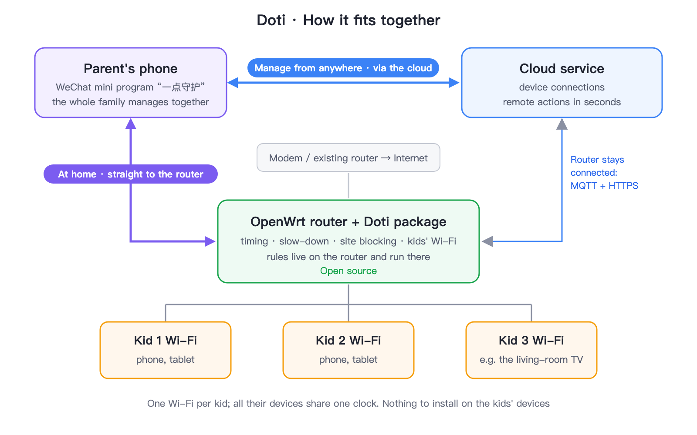
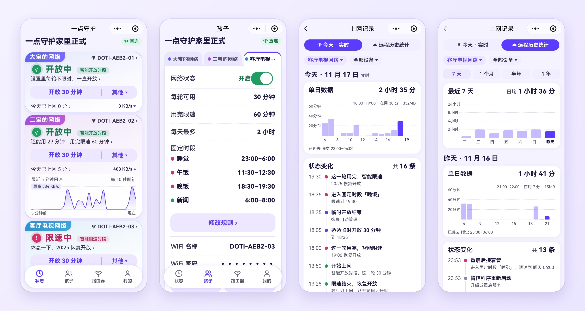

<div align="center">

<a href="https://doti.top/?lang=en"><picture>
  <source media="(prefers-color-scheme: dark)" srcset="assets/banner-en-dark.png">
  
</picture></a>

**Screen time for kids · an OpenWrt router package**

[](../../releases)
[](https://openwrt.org/)
[-6d4ce8)](#technical-features)
[](LICENSE)

**[Homepage doti.top](https://doti.top/?lang=en)** · **[Quick Start](https://doti.top/quick-start.html?lang=en)** · WeChat mini program “一点守护” · [中文](README.md)

</div>

---

Doti is screen time for kids, handled by your OpenWrt router. The kids' internet **runs a while, then slows a while**, on its own — no fixed time slots to wait for. When time's up it just slows down and never cuts off, so messages and homework lookups still work. Parents manage everything from the WeChat mini program “一点守护”, and nothing gets installed on the kids' devices.

| Automatic | Flexible | Never offline | Nothing to install |
|---|---|---|---|
| Runs a while, slows a while, on its own | The clock starts whenever the kids start | Time's up only slows things down; messages still go through | Lives on the router; nothing on the kids' devices |

## How it fits together



- **Router package (this repository)**: timing, slow-downs, site blocking and the kids' Wi-Fi all live on the router; rules are stored and enforced there.
- **WeChat mini program “一点守护”**: for parents. At home on the parents' Wi-Fi it talks to the router directly, skipping the cloud; away from home it goes through the cloud.
- **Cloud service**: keeps routers connected — an MQTT doorbell plus HTTPS sync, so parents' actions from outside arrive within seconds.

## Screenshots

Parent side: status, a kid network's rules, today's usage, usage history



Kid side: joining, network open, network resting, asking a parent for time


## Quick start

1. **Flash official OpenWrt 22.03 or later** (24.10 recommended for a fresh flash).
2. **SSH into the router and run one command** (it detects the system, downloads the matching package, verifies and installs it — 30–50 seconds):

   ```sh
   cd /tmp && wget -O install.sh https://gitee.com/xautlx/doti-kids-router/raw/main/install.sh && sh install.sh
   ```

3. **Join the parents' Wi-Fi `DOTI-XXXX-ADMIN`** with your phone, open the WeChat mini program “一点守护” and follow the pairing steps.

No router yet? The mini program has a full demo for both the parent and the kid side.

| | GitHub Pages | Faster in China |
|---|---|---|
| Homepage | [xautlx.github.io/doti-kids-router](https://xautlx.github.io/doti-kids-router/?lang=en) | [doti.top](https://doti.top/?lang=en) |
| Quick Start (flashing tips, installing without a command line, verifying packages) | [xautlx.github.io/doti-kids-router/quick-start.html](https://xautlx.github.io/doti-kids-router/quick-start.html?lang=en) | [doti.top/quick-start.html](https://doti.top/quick-start.html?lang=en) |

Packages are in [Releases](../../releases) (also mirrored to the gitee repository of the same name).

## Why

- **Homework's done, but they have to wait for the time slot**: typical parental controls only know “online from X to Y”, so finishing early means sitting around; a daily total just gets used up in one long sitting.
- **Time's up, but they can't stop**: a hard cut-off lands mid-chat or mid-search, and the bargaining starts — leaving the parent as the bad guy.
- **Too many devices**: per-device rules mean switching from the phone to the tablet when time's up; no single device goes over, but the total does.

Too loose and they get hooked; too strict and it hurts the relationship. Doti takes another route: the internet is always there, only the speed takes turns, and the router is the one saying “time's up”.

## How it works for families

1. **Go online any time**: the network is always on, and the clock starts whenever the kids start; idle devices don't count.
2. **Slows down automatically**: after one round (say 30 minutes) the speed drops — never disconnects, so messages and lookups still work, while video and games become hard to use.
3. **Speed comes back by itself**: after the slow stretch (say 60 minutes) full speed returns, and the next round starts the next time they go online.

Also:

- 🌙 **Fixed periods**: bedtime, meals and online classes get their own schedule — always slow or always open.
- ⏱ **Daily limit**: once the day's total is used up, no new rounds start.
- 🚫 **Site blocking**: adult, gambling and scam sites are always blocked; games, short videos and streaming can be blocked per kid, plus your own list.
- 👨‍👩‍👧 **Per kid, not per device**: up to three kids' Wi-Fi networks with their own rules; all of one kid's devices share one clock; a shared living-room TV can have its own network; the parents' Wi-Fi is never limited.
- 📲 **Open it up on the spot**: online class, research, a reward for finishing a book — one tap in the mini program opens it up, even when you're out.
- 📖 **Earn time with a check-in**: kids can send a photo of their reading or homework to ask for more time — building the habit along the way.
- 📊 **Usage records**: today's usage by hour and by device, plus trends over 7 days, 1 month, 6 months and 1 year.
- 👴 **The whole family**: all it takes is WeChat — grandparents join with one tap on an invite; kids need no account.

The durations above are only examples — parents set their own.

## Peace of mind

- **Time, not content**: Doti manages speed and duration only; it never records which sites kids visit.
- **At home, straight to the router**: at home the phone talks to the router directly, and management actions skip the cloud; the cloud only handles sign-in, sync and the previous day's usage totals.
- **Wi-Fi passwords stay home**: parents' and kids' Wi-Fi passwords live only on the router and your own devices.
- **Open source, open to inspection**: the router software is this repository; packages are built reproducibly by GitHub Actions from public code.

## Requirements and tested devices

- **System**: official OpenWrt 22.03 or later (needs firewall4 / nftables); ipk on 22.03–24.10, apk on 25.x — the installer picks automatically.
- **Hardware**: pure script, any CPU architecture; even 8 MB-flash routers work (at least 800 KB free before installing).
- **Tested**:

  | Device | SoC | OpenWrt | Result |
  |---|---|---|---|
  | Phicomm K2P | MT7621 | 22.03.0, 24.10.8, 25.12.6 | clean installs pass; in daily use |
  | Phicomm K2 | MT7620, 8 MB flash | 24.10.8 | clean install passes; about 900 KB left |

  Other models: reports welcome (please include the model and OpenWrt version in the issue). ImmortalWrt and other firmware based on recent OpenWrt usually work too.

## What installing changes on your router

- Up to 3 kid networks (separate subnets, `10.10.1–3.0/24` by default and moved automatically if that clashes with your upstream network; separate firewall zones; Wi-Fi `DOTI-<code>-01`–`03`) plus the parents' Wi-Fi `DOTI-<code>-ADMIN`; your existing Wi-Fi and LAN are left alone.
- A timezone still set to UTC becomes Asia/Shanghai; flow offloading is turned off if enabled (otherwise limits and counters don't apply).
- Missing dependencies are installed (usually just `mosquitto-client-nossl` and a few small libraries), trying mirrors in China first; your package feed configuration isn't changed.
- If root has no password, it's set to the parents' Wi-Fi password after pairing; a password you set yourself is kept.

## Technical features

- **Pure script, any architecture**: the daemon is written in ucode, which ships with OpenWrt — no compiled binaries, so it runs on any CPU and is light enough for older routers.
- **Slow down, never cut off**: each kid's Wi-Fi is its own network; the daemon rotates open and slow periods by the rules, limiting bandwidth with nftables and capping the UDP packet rate games rely on — the connection stays up, so messages and lookups keep working.
- **Timed per kid, not per device**: the phone and tablet on one kid's Wi-Fi share the same clock, so switching devices doesn't help; time counts only while traffic actually flows, measured against each device's learned background noise.
- **DNS blocking that sticks**: a dnsmasq per kid network; every port-53 query from a kid network is redirected to it, so changing the DNS by hand doesn't help; common encrypted DNS (DoT, DoH) can optionally be blocked.
- **Home LAN left alone by default**: printers and the NAS don't count toward time and aren't slowed; households with a side router or proxy can include the LAN too.
- **Local first, privacy first**: at home the mini program manages the router directly over a LAN HTTP API with signed tickets; the WAN side is refused, and kid networks only see their own status.
- **Remote in seconds**: an MQTT doorbell tells the router to sync with the cloud over HTTPS right away, so parents' actions arrive within seconds.
- **Reproducible builds, signed updates**: the same source produces the same file anywhere, checkable against the published SHA256; online updates only come from this repository's releases, are installed after checking the signed SHA256, and roll back on failure.

## Build it yourself

```sh
python3 build.py         # → dist/doti-kids-router_<version>-1_all.ipk, dist/doti-kids-router-updater_<version>-1_all.ipk
python3 build.py --apk   # also dist/doti-kids-router-<version>-r1.apk, dist/doti-kids-router-updater-<version>-r1.apk (needs apk-tools 3, e.g. in Alpine 3.24)
```

Check the result against `SHA256SUMS` in Releases; pushing a `v<version>` tag makes GitHub Actions build and publish to Releases.

## Layout

| Path | Contents |
|---|---|
| `files/` | Files the `doti-kids-router` package installs on the router |
| `updater/` | The `doti-kids-router-updater` updater |
| `blocklist/` | Site blocklists (always-on, games, short video & live streaming, films & series) |
| `build.py` | Build script |
| `install.sh` | Install script (detects the system, downloads the matching package, verifies and installs it) |

## Feedback

- Install problems or bugs: open an [issue](../../issues) with the router model, OpenWrt version and installer output.
- Questions and suggestions: WeChat mini program “一点守护” → “我的 → 联系客服”.

## License

[Apache-2.0](LICENSE): free to use, modify, use commercially and redistribute. The names “一点守护” and “Doti” and their logos are not covered — see [NOTICE](NOTICE).

About the site blocklists in `blocklist/`: the adult and gambling domains in the always-on list (`always.txt`) come from [StevenBlack/hosts](https://github.com/StevenBlack/hosts) (MIT); the optional lists for games, short video & live streaming, and films & series were collected from public information on the internet. Each file explains what it includes at the top. Additions and corrections are welcome via issues.
