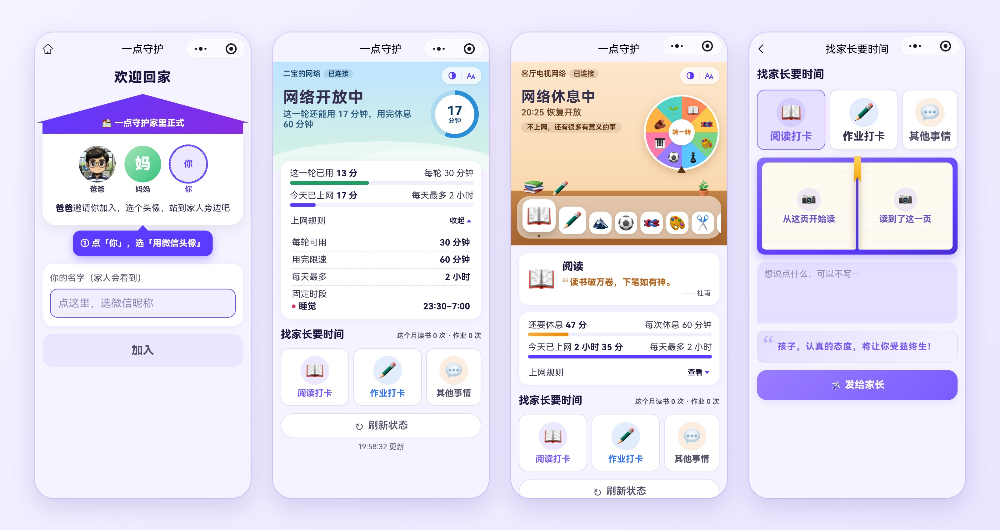

# doti-kids-router · Doti (router side)

> Doti, made with heart. A little more care, a lot more room to grow.

[中文](README.md)

Doti is screen time for kids, handled by your OpenWrt router. The kids' internet **runs a while, then slows a while**, on its own — no fixed time slots to wait for. When time's up it just slows down and never cuts off, so messages and homework lookups still work. Parents manage everything from the WeChat mini program “一点守护”, and nothing gets installed on the kids' devices.

This repository is the router software (the `doti-kids-router` package and the `doti-kids-router-updater` updater), fully open source.

| Automatic | Flexible | Never offline | Nothing to install |
|---|---|---|---|
| Runs a while, slows a while, on its own | The clock starts whenever the kids start | Time's up only slows things down; messages still go through | Lives on the router; nothing on the kids' devices |

## Why

- **Homework's done, but they have to wait for the time slot**: typical parental controls only know “online from X to Y”, so finishing early means sitting around.
- **Time's up, but they can't stop**: a hard cut-off lands mid-chat or mid-search, and the bargaining starts — leaving the parent as the bad guy.

Too loose and they get hooked; too strict and it hurts the relationship. Doti takes another route: the internet is always there, only the speed takes turns, and the router is the one saying “time's up”.

## How it works for families

1. **Go online any time**: the network is always on, and the clock starts whenever the kids start.
2. **Slows down automatically**: after one round (say 30 minutes) the speed drops — never disconnects, so messages and lookups still work, while video and games become hard to use.
3. **Speed comes back by itself**: after the slow stretch (say 60 minutes) full speed returns, and the next round starts the next time they go online.

Also:

- 🌙 **Fixed periods**: bedtime, meals and online classes get their own schedule — always slow or always open.
- ⏱ **Daily limit**: once the day's total is used up, no new rounds start.
- 🚫 **Site blocking**: adult, gambling and scam sites are always blocked; games, short videos and streaming can be blocked per kid, plus your own list.
- 👨‍👩‍👧 **Each kid separately**: up to three kids' WiFi networks with their own rules; all of one kid's devices count together; the parents' WiFi is never limited.
- 📲 **Open it up on the spot**: online class, research, a reward for finishing a book — one tap in the mini program opens it up; with remote management, even when you're out.
- 📊 **Usage records**: today's usage by hour and by device; with remote management, trends over 7 days, 1 month, 6 months and 1 year.

The durations above are only examples — parents set their own.

## Screenshots

Parent side: status, a kid network's rules, today's usage, remote usage history


Kid side: joining, network open, network resting, asking a parent for time



Kids can open the mini program too, to see whether their network is open or resting and how much time is left; while it's resting, it suggests offline things worth doing — reading, sports, drawing. Want a bit more time? They can send a parent a photo of their reading or homework, or just say why.

## Peace of mind

- **Time, not content**: Doti manages speed and duration only; it never looks at what kids do online.
- **At home, no cloud involved**: at home the phone talks to the router directly. With remote management on, the cloud only receives the previous day's usage durations — no content.
- **WiFi passwords stay home**: parents' and kids' WiFi passwords live only on the router and your own devices.
- **Open source, open to inspection**: the router software is this repository; anyone can check what it does.

## Quick install

**Requirements**: OpenWrt 22.03 or later (24.10 recommended for a fresh flash). The package is pure script, so it works on any CPU architecture.

Run on the router (it detects the system, downloads the matching package, verifies and installs it):

```sh
wget -O install.sh https://gitee.com/xautlx/doti-kids-router/raw/main/install.sh && sh install.sh
```

Then join the router's parents' WiFi with your phone, open the WeChat mini program “一点守护” and follow the pairing steps. No router yet? The mini program has a full demo mode.

The overview, detailed install and pairing steps, and how to verify the packages are on the homepage and in the Quick Start:

| | GitHub Pages | Faster in China |
|---|---|---|
| Homepage | [xautlx.github.io/doti-kids-router](https://xautlx.github.io/doti-kids-router/?lang=en) | [doti.top](https://doti.top/?lang=en) |
| Quick Start | [xautlx.github.io/doti-kids-router/quick-start](https://xautlx.github.io/doti-kids-router/quick-start/?lang=en) | [doti.top/quick-start](https://doti.top/quick-start/?lang=en) |

Packages are in [Releases](../../releases) (also mirrored to the gitee repository of the same name).

## Technical features

- **Pure script, any architecture**: the daemon is written in ucode, which ships with OpenWrt — no compiled binaries, so it runs on any CPU; it installs on OpenWrt 22.03 and later and is light enough for older routers.
- **Slow down, never cut off**: each kid's WiFi is its own network; the daemon rotates open and slow periods by the rules, limiting bandwidth with nftables and capping the UDP packet rate games rely on — the connection stays up, so messages and lookups keep working.
- **Timed per kid, not per device**: phones, tablets and the TV on one kid's WiFi share the same clock, so switching devices doesn't help; time counts only while traffic actually flows.
- **DNS blocking that sticks**: a dnsmasq blocking DNS per kid network; every port-53 query from a kid network is redirected to it, so changing the DNS by hand doesn't help; common encrypted DNS (DoT, DoH) can optionally be blocked.
- **Local first, privacy first**: at home the mini program manages the router directly over a LAN HTTP API with signed tickets; the WAN side is refused, and kid networks only see their own status. Browsing content is never recorded, and WiFi passwords never leave home.
- **Remote in seconds**: with remote management on, the router syncs with the cloud over HTTPS, and an MQTT doorbell delivers parents' actions within seconds; the cloud only receives the previous day's usage durations.
- **Reproducible builds, signed updates**: the same source produces the same file anywhere, checkable against the published SHA256; packages are built by GitHub Actions from public code, untouched by hand; online updates only come from this repository's releases and are installed after checking the signed SHA256.

## Build it yourself

```sh
python3 build.py         # → dist/doti-kids-router_<version>-1_all.ipk, dist/doti-kids-router-updater_<version>-1_all.ipk
python3 build.py --apk   # also dist/doti-kids-router-<version>-r1.apk, dist/doti-kids-router-updater-<version>-r1.apk (needs apk-tools 3, e.g. in Alpine 3.24)
```

Check the result against `SHA256SUMS` in Releases; pushing a `v<version>` tag makes GitHub Actions build and publish to Releases.

## Layout

| Path | Contents |
|---|---|
| `files/` | Files the `doti` package installs on the router |
| `updater/` | The `doti-kids-router-updater` updater |
| `blocklist/` | Site blocklists (always-on, games, short videos, streaming) |
| `build.py` | Build script |
| `install.sh` | Install script (detects the system, downloads the matching package, verifies and installs it) |

## License

[GPL-3.0](LICENSE).

The adult and gambling domains in the always-on blocklist (`blocklist/always.txt`) come from [StevenBlack/hosts](https://github.com/StevenBlack/hosts) (MIT).
